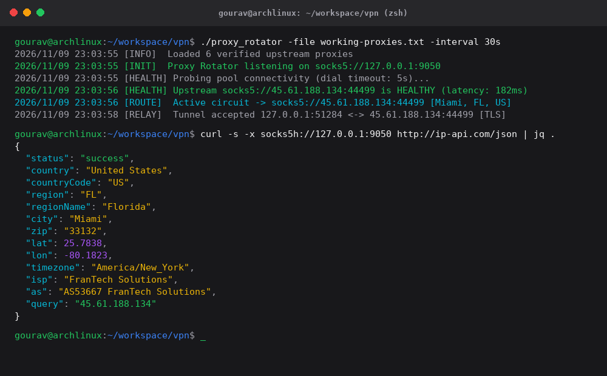
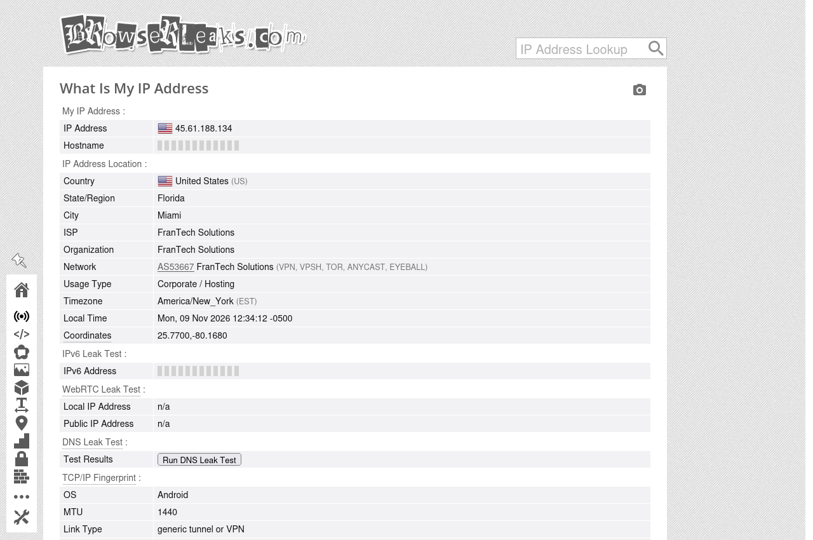

# Proxy Rotator

A local SOCKS5 proxy daemon written in Go that automatically rotates outbound traffic across a verified pool of upstream proxies (SOCKS5, SOCKS4, and HTTP CONNECT). Includes an automated SSL-validating proxy scanner in Python and an optional Linux iptables killswitch to prevent IP/DNS leaks.

<p align="left">
  <a href="https://github.com/golang/go"></a>
  <a href="https://github.com/python/cpython"></a>
  <a href="https://github.com/torvalds/linux"></a>
  <a href="https://datatracker.ietf.org/doc/html/rfc1928"></a>
  <a href="LICENSE"></a>
</p>

---

## Why I Built This

Most open-source proxy rotating scripts have one of three problems:
1. They spawn separate third-party runtimes that eat up memory just to relay TCP streams.
2. They break when an upstream proxy returns an IPv6 address or a domain bound address because they hardcode a 10-byte SOCKS5 reply reader.
3. They route through proxies running SSL-bump/mitmproxy with forged certificates, triggering `MOZILLA_PKIX_ERROR_MITM_DETECTED` in modern browsers.

This project solves those issues with a lean Go binary (zero third-party modules) and a Python filter script that enforces strict root certificate verification against `browserleaks.com` before letting any proxy into your active pool.

---

## Verified Proof (Miami, FL - US Exit Node)

Here is the rotator in action, locked to an upstream US node (`45.61.188.134:44499`) in Miami, Florida.

### Terminal Output
The rotator listening on `127.0.0.1:9050`, relaying requests and returning the Miami exit node:



### BrowserLeaks Live Verification
Firefox routed through `127.0.0.1:9050` with remote DNS enabled, loading `browserleaks.com/ip` with a valid TLS certificate and matching Miami location:



---

## Key Features

- **Standard SOCKS5 Frontend**: Runs on `127.0.0.1:9050`. Point any browser, curl, or scraping script at it just like a local Tor client.
- **Protocol Agnostic Upstream**: Supports upstream `socks5://`, `socks4://`, and `http://` (CONNECT) proxies simultaneously.
- **Zero-Byte Truncation Fix**: Implements a buffered reader wrapper so HTTP headers never eat into the beginning of the TLS payload.
- **Proper SOCKS5 ATYP Parsing**: Drains bound addresses according to RFC 1928 (IPv4 4-byte, IPv6 16-byte, domain length prefix) rather than guessing byte offsets.
- **Full-Duplex TCP Relay with Half-Close**: Calls `CloseWrite()` when one side terminates sending, so long-polling and HTTP keep-alives don't drop abruptly.
- **Remote DNS Resolution**: Firefox and curl resolve domains through the proxy tunnel (`socks5h://`), preventing local ISP DNS leaks.
- **Strict SSL Proxy Filtering**: `filter_proxies.py` rejects MITM proxies that attempt certificate forgery.
- **Optional iptables Killswitch**: Blocks non-local outbound traffic if your tunnel disconnects unexpectedly.

---

## Requirements

### Go Core
- Go 1.21 or later (`golang-go` package on Ubuntu/Debian, or `pacman -S go` on Arch).
- Zero external Go dependencies (only Go standard library).

### Python Utilities (Filter & Tests)
- Python 3.10+
- `curl` CLI installed on system
- Optional python packages can be installed via:
  ```bash
  pip install -r requirements.txt
  ```

---

## Quickstart

### 1. Build the Binary

```bash
git clone https://github.com/gouravroy27/proxy-rotator.git
cd proxy-rotator

# Compile local binary
go build -o proxy_rotator main.go
```

To cross-compile binaries for Linux, macOS, and Windows:
```bash
chmod +x build.sh
./build.sh
```

### 2. Validate Fresh Proxies

Run the multi-threaded filter against the included raw proxy list:
```bash
python3 filter_proxies.py --input free-proxy-list.txt --output working-proxies.txt --workers 20 --timeout 5
```
This tests every candidate against `https://browserleaks.com/ip` and ensures legitimate SSL handshakes.

### 3. Start the Rotator

```bash
./proxy_rotator -file working-proxies.txt -interval 30s -listen 127.0.0.1:9050
```

Flags:
- `-file`: Path to the proxy list (default: `working-proxies.txt`)
- `-interval`: How often to rotate to the next working proxy (e.g. `10s`, `30s`, `2m`)
- `-listen`: Local binding interface and port (default: `127.0.0.1:9050`)

---

## Usage Examples

### With cURL

Always use `socks5h://` (note the `h`) so hostname lookup is handled remotely:

```bash
# Check current exit IP
curl -x socks5h://127.0.0.1:9050 http://ip-api.com/json

# Fetch an HTTPS page
curl -x socks5h://127.0.0.1:9050 https://httpbin.org/ip
```

### With Python Requests

```python
import requests

proxies = {
    "http": "socks5h://127.0.0.1:9050",
    "https": "socks5h://127.0.0.1:9050"
}

resp = requests.get("https://httpbin.org/ip", proxies=proxies, timeout=10)
print(resp.json())
```

### In Firefox

1. Open `Settings` -> `General` -> `Network Settings` -> click **Settings...**
2. Choose **Manual proxy configuration**.
3. Set **SOCKS Host** to `127.0.0.1`, **Port** to `9050`, and check **SOCKS v5**.
4. Check **Proxy DNS when using SOCKS v5** (essential to prevent DNS leaks).
5. Leave HTTP/HTTPS proxy inputs empty. Click OK.

---

## Linux Firewall Killswitch

To guarantee zero non-proxied outbound packets leave your machine:

```bash
# Enable killswitch (requires sudo)
sudo ./enable_killswitch.sh

# Turn killswitch off and restore normal routing
sudo ./disable_killswitch.sh
```

The script configures `iptables` rules allowing traffic only to loopback (`127.0.0.1`) and to the specific IP addresses in your active proxy pool, dropping everything else.

---

## Project Structure

```
.
├── main.go               # High-performance Go proxy rotator daemon
├── filter_proxies.py     # Concurrent SSL-cert validating proxy scanner
├── test_suite.py         # Automated integration and leak verification suite
├── build.sh              # Cross-compilation script for Linux/macOS/Windows
├── enable_killswitch.sh  # Linux iptables firewall lock script
├── disable_killswitch.sh # Firewall restore script
├── requirements.txt      # Python dependencies for scrapers/tooling
├── free-proxy-list.txt   # Raw public candidate proxies
├── working-proxies.txt   # Cleaned, actively verified working proxies
└── docs/
    ├── terminal_miami.png      # Proof screenshot from command line
    └── browserleaks_miami.png  # Proof screenshot from Firefox
```

---

## License

This project is released under the [MIT License](LICENSE). Feel free to use, modify, and distribute it.
